<div align="center">

# GymGoGo Growth Lab

**AI-Powered Fitness Party Game**

不用手柄，靠深蹲打怪！一款把体感运动、AI 健身知识挑战与朋友合作结合起来的互动派对游戏。

[**🎮 在线体验**](https://gymgogo-growth-lab.pages.dev/) · [玩法与关卡](#核心玩法) · [产品与数据](#产品设计与数据驱动) · [本地运行](#本地运行) · [GitHub](https://github.com/2033124642rose-create/gymgogo-growth-lab)


*真实产品首页截图，复用已有展示素材；游戏内品牌为 GymGoGo。*

</div>

## 产品介绍

朋友聚在一起，除了聊天、看屏幕，还能一起玩什么？GymGoGo 把电脑摄像头变成体感入口：轮流下蹲、起立攻击怪兽，再用一句自己的话回答 AI 怪兽的提问。动作、答题和队友接力串成一场三关冒险，让轻量运动成为共同娱乐的一部分。

**一台电脑 · 一个摄像头 · 2–6 位朋友。** 无需手柄、无需注册游戏账号，也不需要多人同时进入画面。

适合朋友聚会、大学宿舍、家庭互动和团队破冰；也可以一个人先来一场短挑战。这是一款趣味动作游戏，不是专业健身考核或医学诊断工具。

Growth Lab 在完整游戏之上加入匿名行为采集与私有分析后台：既关注“玩起来是否有趣”，也研究“用户来到首页后，为什么没有真正开始游戏”。

## 核心玩法

| 玩法 | 可以体验什么 |
| --- | --- |
| **单人挑战** | 首页下方直接准备挑战，完成 10 次有效深蹲击败怪兽；另有明确标注的按钮演示。 |
| **本地多人派对** | 2–6 人输入昵称、选择帽子，在同一设备轮流挑战；不是在线联机。 |
| **体感战斗** | 摄像头显示骨骼关键点，明显下蹲再起立即计一次，每次造成 10 点伤害。准备后走远就位，自动倒计时开局。 |
| **AI 知识挑战** | 创建派对时勾选开启。每位玩家每关完成动作目标后，回答一道动态生成的基础健身常识题。 |
| **自然语言判题** | 输入简短答案，AI 理解核心含义；答对 Bingo 并继续，明确答错才触发怪兽占屏与本关失败。 |
| **AR 帽子与声音** | 皇冠、海盗帽、魔法帽、派对帽跟随当前玩家头部；受击音效、语音提示和怪兽吐槽增加互动，声音可关闭。 |
| **合作与结算** | 支持休息、跳过、换人；三关结束展示实际完成次数、个人贡献与获得的徽章。 |

### 一场冒险如何进行

**创建派对 → 选择帽子与玩法 → 摄像头就位 → 深蹲攻击 → AI 问答 → 下一位玩家 → 解锁下一关 → 团队结算**


*真实产品玩法介绍截图。AI 问答属于可选派对玩法，单人挑战不包含三关问答。*

| 关卡 | 怪兽 | 每位玩家的动作目标 | AI 模式的额外目标 | 通关奖励 |
| --- | --- | --- | --- | --- |
| 史莱姆森林 | 史莱姆团子 | 2 次深蹲 | 答对 1 道题 | 萌芽伙伴徽章 |
| 幽灵秘境 | 迷雾幽灵 | 3 次深蹲 | 答对 1 道题 | 驱雾小队徽章 |
| 巨龙城堡 | 城堡巨龙 | 4 次深蹲 | 答对 1 道题 | 屠龙同盟徽章 |

AI 模式下，**全员完成动作且答题正确**才解锁下一关，Boss 血量清空不代表已经过关。答题不限时，姿态识别进入待机，可以走近电脑输入答案。AI 无法判断、网络异常或服务额度不足时，不会直接判失败或错误解锁关卡，按页面提示重试、休息或安全退出即可。

也可以选择纯运动派对，只完成动作目标。最终结算展示已有的次数、贡献和徽章，不包含尚未实现的 AI 团队战报或排行榜。

## AI 在产品中的作用

体感识别和大模型各司其职，让 AI 参与有意义的互动，而不是决定所有游戏规则。

| 能力 | 实际实现 | 对体验的作用 |
| --- | --- | --- |
| 人体姿态识别 | **MediaPipe Pose Landmarker**，浏览器本地推理 | 从摄像头画面提取人体关键点，不依赖大模型看视频。 |
| 动作计数与战斗 | **确定性状态机与游戏规则** | 判断下蹲→起立、扣血、轮换、解锁关卡，避免大模型随意修改成绩。 |
| 知识出题 | **阿里云百炼 qwen-flash** | 根据关卡生成简短的基础运动常识题，减少固定题库的重复感。 |
| 语义判题与角色反馈 | **qwen-flash** 返回结构化判定和 `monsterReaction` | 接受合理的不同表述，为怪兽生成当次互动吐槽；无法确定时保留重试机会。 |
| 语音与音效 | **浏览器 SpeechSynthesis 与 Web Audio** | 播放就位提示、Bingo、怪兽吐槽与攻击音效；当前采用调皮搞怪风格，不额外调用付费 TTS。 |

出题与判题通常各需要一次模型请求，不为播报再次调用模型。AI 仍可能出错，因此保留 `correct / incorrect / uncertain` 和服务异常状态；语音效果取决于设备可用的本地声音，播放失败时保留文字，游戏继续运行。

## 产品设计与数据驱动

### 从“做出游戏”走向“理解用户为何没有开局”

当前版本是**具备埋点和私有分析后台的 V1 基线**。核心观察指标为：

> **有效开局率 = 成功进入真实游戏 active 状态的首页访问会话数 ÷ 首页访问会话数**

使用匿名会话而非真实身份统计，按会话去重，并结合事件时间顺序分析路径。

| 核心事件 | 业务含义 |
| --- | --- |
| `page_view` | 匿名会话首次进入首页。 |
| `start_click` | 点击单人或多人游戏入口。 |
| `mode_select` | 进入相应模式流程，可以与入口点击由同一次操作触发。 |
| `game_start` | 真正进入 active、开始有效游戏；不是打开摄像头、点击准备或开始倒计时。 |

**已实现的分析链路：** 前端埋点 → Pages Functions 校验与去重 → D1 保存 → SQL 漏斗 → 私有数据看板。

看板提供首页访问会话数、入口点击率、有效开局率、点击后开局率、转化漏斗、单人/多人路径对比和最近 7 天 / 30 天趋势。管理员可导出聚合 CSV，演示查看者只读聚合数据。

指标解释保留必要边界：会话数不等于真实用户人数；首页主入口默认进入派对，不代表用户主动偏好多模式；按钮演示不计入有效开局；数据丢报、退出统计和跨标签页访问也会影响结果。四个事件用于定位流失阶段，不能单独解释用户退出的具体原因。

**下一步规划：** 在稳定基线上收集真实数据 → 结合反馈定位阻塞点 → 制定 V2 策略 → 设计对照实验并评估效果。**V2 优化和 A/B 实验尚未实施**，当前不宣称任何转化提升或实验结论。

## 技术架构

```mermaid
flowchart TB
  subgraph Client[浏览器：游戏前台]
    UI[React + TypeScript · Vite]
    Pose[MediaPipe 本地姿态识别]
    Game[动作与关卡状态机 · AR 帽子]
    Voice[SpeechSynthesis · Web Audio]
    Event[四个匿名行为事件]
    Pose --> Game
    UI --> Game
    Game --> Voice
    UI --> Event
  end

  subgraph Pages[Cloudflare Pages]
    Static[静态游戏页面]
    Quiz[Pages Functions · 问答接口]
    Collect[Pages Functions · 事件接收]
    Admin[私有后台 · 登录与统计 API]
  end

  subgraph AI[独立 AI 服务]
    Worker[Cloudflare Worker]
    Budget[SQLite Durable Object · 权威额度与幂等状态]
    Qwen[百炼 qwen-flash]
    Worker --> Budget
    Worker --> Qwen
  end

  D1[(Cloudflare D1 · 行为事件与后台认证辅助表)]
  Static --> UI
  UI -->|题目与文字答案| Quiz
  Quiz -->|QUIZ_SERVICE 服务绑定| Worker
  Event --> Collect
  Collect --> D1
  Admin -->|鉴权后查询聚合统计| D1
```



- **前端**：React 19、TypeScript、Vite 7、CSS / Canvas 和 Lucide 图标；MediaPipe 的模型与 WASM 资源随站点提供。
- **AI 服务**：Pages Functions 转发到独立 Worker，复用统一模型调用层；SQLite Durable Object 持久化维护额度预留、限流和幂等。存储校验失败时停止模型调用。
- **数据服务**：D1 支撑事件采集与私有后台；与 AI 预算账本分离。登录和统计 API 都在服务端鉴权，使用安全会话 Cookie。
- **密钥保护**：模型 Key 仅配置在 Worker Secret，不进入浏览器、`VITE_` 变量或仓库。服务配置错误时返回真实异常，不用模拟内容冒充 AI。
- **验证方式**：Vitest、Testing Library 与 Cloudflare 本地模拟环境覆盖状态机、问答、预算、埋点及权限。自动测试、模拟验证与真人体验分别记录，不互相替代。

## 产品体验

### 直接在线游玩

[**打开 GymGoGo Growth Lab →**](https://gymgogo-growth-lab.pages.dev/)

1. 推荐使用带摄像头的电脑和 Chrome / Edge，先腾出活动空间，保持适当光线。
2. 首页点击「立即开始」创建 2–6 人派对，填昵称、选帽子；想体验 AI 问答，需要勾选「开启 AI 知识挑战」。单人玩法在首页下方。
3. 点击「开启摄像头」并授权，再点击「准备挑战」。走远让主要关节入镜，站稳后等待自动倒计时结束。
4. 完成下蹲和起立，观察攻击与计数。需要站远时，可进入战斗大屏，并先通过「语音试听」确认声音。
5. AI 派对完成个人动作目标后，走近电脑答题；按结果继续轮换或重新挑战本关。

AI 服务受可用性与调用额度保护，以派对页检查结果为准。无需提供个人 API Key；服务不可用时仍可选择纯运动玩法。

### 数据分析后台

[**GymGoGo Analytics 登录 →**](https://gymgogo-growth-lab.pages.dev/admin/login)

后台已正式发布，**需要项目维护者授权的账号**。游戏前台无需登录，也不展示后台入口；仓库不提供任何账号、密码或绕过权限的方式。

| 角色 | 权限 |
| --- | --- |
| Admin | 查看聚合指标、漏斗与趋势，导出聚合 CSV。 |
| Viewer | 查看授权的聚合指标、漏斗与趋势，不提供 CSV 导出或原始事件查看。 |

未登录访问后台会跳转登录页，统计 API 独立验证身份。演示时由维护者私下提供 Viewer 账号；README 不展示真实运营数据或会话标识。

### 隐私与使用边界

摄像头视频与人体关键点用于浏览器本地处理，应用不上传或录制原始视频。AI 问答会将题目、参考信息和提交的文字答案交给百炼处理，服务端保存匿名题目与判定；请勿填写个人敏感信息。匿名行为统计可在页面退出，原始事件计划保留 30 天，通过清理命令执行，**并非自动到期删除**。

无需真实姓名，不要求麦克风权限。按自身情况调整动作幅度，随时休息，身体不适时停止；产品不评价姿势是否专业标准，也不计算未经验证的健康收益。

## 项目实践与个人贡献

这是一次从产品想法、交互原型到真实 AI 接入、上线和行为分析的完整实践，使用 **Vibe Coding 与 Codex 协作实现**。

| 工作方向 | 产品负责人承担 | AI 编程助手协助 |
| --- | --- | --- |
| 定位与需求 | 确定聚会场景、目标用户、玩法边界与开发优先级 | 审查已有实现、拆解任务与技术风险 |
| 交互与迭代 | 提出大屏、无接触开局、宽松计数、轮换和答题待机需求，亲自真人验收 | 编写界面和状态机、定位问题、补充测试 |
| AI 与发布 | 决定模型、费用保护和开放范围；亲自在官方控制台配置凭据、完成必要授权 | 实现模型调用、服务端安全保护、独立资源配置与授权范围内的发布验证 |
| 数据与策略 | 定义有效开局率、四个事件和会话口径，选择先建 V1 基线再做策略实验 | 实现埋点、D1、SQL、私有看板与权限测试 |

代码、测试与部署操作大量由 AI 编程助手协助完成；产品决策、问题发现和真人验收由负责人主导。不将辅助生成的代码表述为完全独立手工编写，也不将待开展的实验表述为既有成果。

## 本地运行

**环境：** Git、npm，推荐 Node.js 22.12+ 的 22.x 版本；项目 Vite 7 要求 Node.js `^20.19.0 || >=22.12.0`。可从 [Node.js 官网](https://nodejs.org/en/download) 安装。

```bash
git clone https://github.com/2033124642rose-create/gymgogo-growth-lab.git
cd gymgogo-growth-lab
npm ci
npm run dev
```

浏览器打开 **http://127.0.0.1:5174/**。安装时会自动准备 MediaPipe 运行资源，模型文件已随项目提供。摄像头仅在主动点击后申请权限，停止开发服务按 `Ctrl+C`。

**无需环境变量或个人 Key，即可运行本地游戏。** 当前 Vite 配置主动关闭真实 AI，单纯填写 `.env.local` 不会开启问答；本地纯运动功能可用，完整真实 AI 体验优先使用正式网站。Vite 本身也不提供 D1 与后台登录 API，需要完整本地云端模拟时参考下方文档。

```bash
npm test -- --maxWorkers=1
npm run typecheck
npm run build
npm run check:cloud
```

`check:cloud` 仅离线编译与部署 dry-run，不发布；`npm run deploy` 保留保护性阻止。独立部署需要自行配置 Pages、Worker、服务绑定与 Secret，不会自动获得维护者的云端资源或凭据。

### 继续了解

- [AI 服务配置说明](docs/AI服务配置说明.md) · 配置接口与服务端密钥管理，Growth Lab 本地限制以本 README 和当前配置为准。
- [埋点实施与验收](docs/GymGoGo2.0-埋点实施与验收.md) · 事件口径与验证边界。
- [SQL 漏斗分析指南](docs/GymGoGo2.0-SQL漏斗分析指南.md) · 本地 D1 调试、SQL 与数据清理。
- [后台登录与数据看板说明](docs/GymGoGo2.0-后台登录与数据看板说明.md) · 账号授权与聚合数据访问。

`docs` 保留了原版与各阶段的历史记录；其中旧状态、旧资源名不等于当前 Growth Lab 配置。游戏功能与当前源码、正式网站一致，后续策略迭代以真实数据和独立验收为依据。
