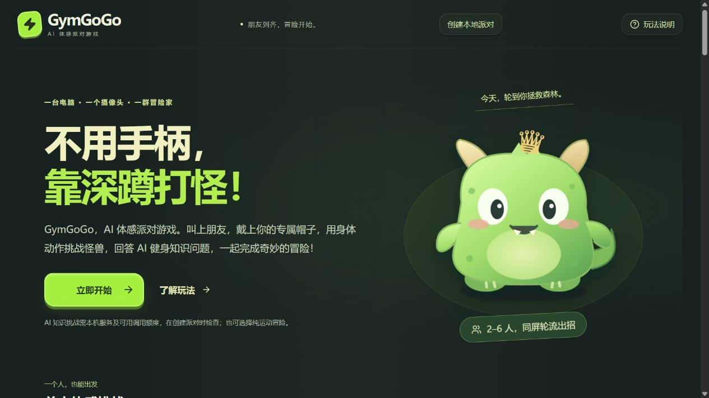
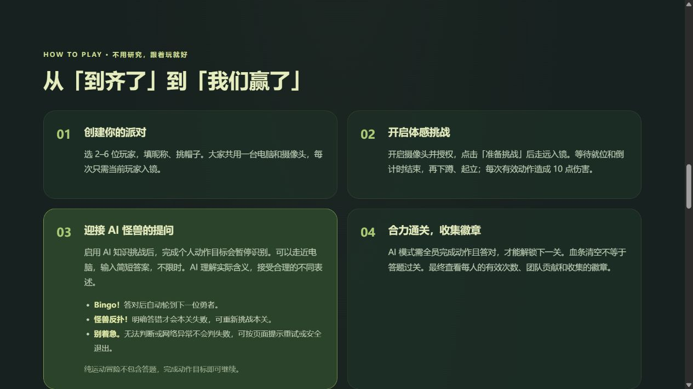
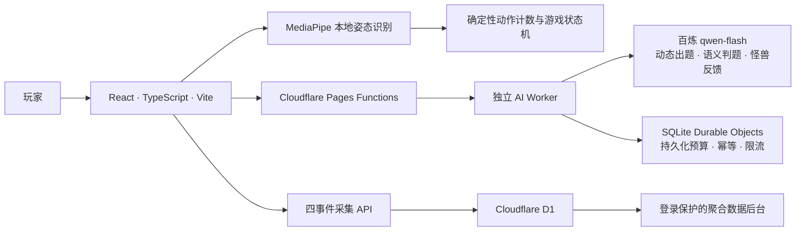

<div align="center">

# GymGoGo Growth Lab

### AI体感互动游戏｜数据驱动产品迭代实践

不用手柄，靠深蹲打怪。用身体动作攻击怪兽，用自己的话回答AI问题，和朋友一起完成冒险。

[**🎮 立即体验**](https://gymgogo-growth-lab.pages.dev/) · [产品迭代](#产品如何迭代) · [验证成果](#产品验证成果) · [本地运行](#本地运行)



*真实历史首页截图（2026-10-30）。现正式入口使用V2模式选择，具体界面以线上版本为准。*

</div>

## 这是什么产品

朋友聚在一起，除了聊天和看屏幕，还能一起玩什么？GymGoGo通过人体动作识别与生成式AI，把真实运动转化为怪兽战斗和知识互动。无需手柄、无需注册，单人可玩，2–6位朋友也能共用一台设备轮流合作。

适合朋友聚会、宿舍娱乐、家庭互动和团队破冰。推荐带摄像头的电脑；手机需固定摆放，调整距离和角度，让肩膀、髋部、双膝及脚踝进入画面。它是趣味运动游戏，不是专业动作考核或医学诊断工具。

**Growth Lab不仅交付游戏，也建立了从行为数据、用户反馈到方案设计、验证与发布的产品迭代流程。**

## 已经可以玩什么

| 模块 | 实际体验 |
| --- | --- |
| 体感战斗 | MediaPipe在浏览器识别人体关键点，明显下蹲再起立计一次，驱动怪兽受击与扣血；准备后就位并自动倒计时。 |
| 单人挑战 | 完成10次有效动作击败森林怪兽，另有明确标注的按钮演示。单人不含AI问答。 |
| 多人协作 | 2–6人在同一设备轮流挑战，支持昵称、四款头部跟随AR帽子、跳过、休息和团队贡献结算，不做在线联机。 |
| AI知识互动 | 派对中可勾选AI挑战。每人每关完成动作目标后，Qwen动态出题；玩家输入自然语言答案，模型理解语义并生成当次怪兽反馈。 |
| 趣味反馈 | 答对Bingo后接棒；明确答错才出现怪兽占屏与本关失败；uncertain或接口异常不会直接判输。声音可以关闭。 |
| V2新手体验 | 三页图文教程、统一开始入口、单人/多人模式选择、单人自动进入准备流程、摄像头隐私说明与动作状态提示。 |
| 产品分析 | 四个匿名行为事件、D1、SQL漏斗和私有后台，观察用户从首页到真实开局的过程。 |

### 一场派对如何完成

创建派对 → 选择帽子及是否启用AI → 开启摄像头 → 当前玩家准备就位 → 下蹲、起立攻击 → AI问答 → 换人合作 → 解锁下一关 → 团队结算。

| 关卡 | 每人动作目标 | AI模式额外目标 | 奖励 |
| --- | --- | --- | --- |
| 史莱姆森林 | 2次 | 每人答对1题 | 萌芽伙伴徽章 |
| 幽灵秘境 | 3次 | 每人答对1题 | 驱雾小队徽章 |
| 巨龙城堡 | 4次 | 每人答对1题 | 屠龙同盟徽章 |

每次有效动作造成10点伤害。AI模式下全员完成动作且答题正确才通关，血条归零不会绕过问答。答题不限时，人体识别暂停，可以走近键盘。服务异常时提供真实错误、重试和安全退出，不用固定内容冒充AI。

<details>
<summary>查看真实产品玩法介绍截图</summary>



历史素材展示产品玩法，不作为当前V2新手教程截图或最新测试证据。

</details>

## 产品如何迭代

| 阶段 | 产品工作 | 交付 |
| --- | --- | --- |
| 从0到1 | 确定朋友聚会场景，规划动作、怪兽与知识挑战的闭环；通过Vibe Coding与Codex协作开发并验收 | 真实体感、多人三关、AI问答及公网游戏 |
| 数据基线 | 独立部署Growth Lab，设计匿名事件和有效开局指标，使用D1、SQL与私有看板分析路径 | 可追踪首页→点击→真实开局的分析链路 |
| 问题诊断 | 结合探索性漏斗及反馈，发现单人入口难找、首次不会玩、开局操作多、隐私和动作规则不清 | 明确优先优化新用户开局体验 |
| V2方案 | 统一入口先选模式，增加三页图文教程，简化单人准备，补充本地处理及动作提示 | 保留玩法与AI能力的交互改版 |
| 体验验证 | 组织10人分别体验V1/V2，汇总评分和反馈，继续排查模型加载、操作可达性及手机兼容 | 配对可用性复盘与稳定性修复 |
| 稳定发布 | 以电脑与手机真人验收的版本为基础，接入正式V2入口和非实验行为采集 | 默认V2正式体验；保留V1与原测试代码 |

产品负责人主导定位、需求设计、功能取舍、体验组织与验收；Codex协助代码、测试、配置和发布实现。项目不将AI辅助工程工作表述为全部独立手写代码。

## 三个产品优化案例

| 用户问题 | 产品判断 | V2方案 | 验证情况 |
| --- | --- | --- | --- |
| 单人入口不直观，主入口直接进入多人 | 在开始前明确选择，减少错误路径 | 统一“立即开始”→单人/多人模式选择 | 配对体验与负责人验收；不把选择入口当成模式偏好证明 |
| 首次不知道怎么玩 | 用简短可跳过的图文教学解释核心动作，避免长说明增加负担 | 摄像头准备、下蹲起立、开始冒险三页教程；完成后直接选模式，玩法说明可重学 | 三页导航和跳过逻辑自动回归，真人体验验证 |
| 对摄像头、计数与开局状态不清楚 | 保留真实动作条件，同时减少理解成本 | 明确本地处理、下蹲→起立反馈、单人准备流程简化；共享摄像头兼容及失败重试、派对固定操作条 | 验收版本已获电脑和手机确认；不宣称覆盖所有浏览器 |

## 产品验证成果

- 交付真实可玩的AI体感游戏及独立的产品分析系统。
- 建立“数据采集 → 路径分析 → 问题判断 → V2设计 → 用户体验 → 发布”的工作流程。
- **10名用户完成V1/V2配对可用性测试，平均易用性评分由2.8/5提高到4.0/5。** 两版均成功开局；这是配对体验结果，不是线上随机A/B转化提升。
- V1、V2和配对测试依据版本分别保留。实验分流及QA隔离能力已准备，**本次发布不启动50:50随机实验**。

完整测试范围与原始记录由项目负责人本地保存，不公开个人记录、内部运营数据或凭据。开局耗时未采集，不据此宣称效率提升。

## 技术与AI分工



MediaPipe负责人体关键点，规则代码负责计数、扣血和关卡；Qwen负责出题、语义判断与角色反馈；SpeechSynthesis/Web Audio负责当前游戏语音和音效。视频与人体关键点不发送给大模型。模型只由服务端调用，密钥保存在Cloudflare Secret，配合独立持久化预算、输入限制、超时和幂等保护。

四个核心事件为 `page_view`、`start_click`、`mode_select`、`game_start`。有效开局以真实进入active状态为准，不把点击按钮或打开摄像头当作开局；按匿名会话去重。V2入口点击时尚未选模式，模式分布以随后选择的路径解释。

后台提供7/30天趋势、漏斗与单人/多人路径比较。管理员可导出聚合CSV；Viewer只读聚合数据。访问[后台登录页](https://gymgogo-growth-lab.pages.dev/admin/login)需负责人单独授权，不公开账号密码，不开放原始事件查询。

## 立即体验

1. 打开[正式网站](https://gymgogo-growth-lab.pages.dev/)，学习或跳过教程，点击“立即开始”。
2. 选择单人或多人；多人填写昵称、选帽子，按需勾选AI知识挑战。
3. 主动开启摄像头并授权，留出光线和安全活动空间，全身主要关节入镜。
4. 按提示准备，倒计时后下蹲并起立；派对完成个人目标后回答AI问题。

原始摄像头视频不上传、不录制；AI接收题目及玩家提交的文字答案等必要信息。匿名统计可以退出，无需真实姓名。身体不适时立即停止，按自身情况调整动作幅度。

AI公开体验受服务可用性和额度保护约束，异常时以页面实际提示为准。当前最终结算展示次数、贡献和徽章，尚无AI团队战报、排行榜或分享卡片。

## 本地运行

要求：Node.js 22.12+及npm，支持摄像头的现代浏览器。

```bash
git clone https://github.com/2033124642rose-create/gymgogo-growth-lab.git
cd gymgogo-growth-lab
npm ci
npm run dev
```

打开终端显示的 `http://127.0.0.1:5174/`，摄像头只在主动点击后请求权限。`Ctrl+C`停止服务。

```bash
npm test
npm run typecheck
npm run build
```

安装与构建会准备本地MediaPipe资源。本地Vite默认安全关闭真实AI，不需个人Key即可体验页面与纯运动；完整真实AI优先使用公网。不要复制他人的环境文件或Secret。本地服务与Cloudflare配置独立，云端服务需独立Worker、绑定及Secret。

发布与版本依据见[正式V2发布说明](docs/V2正式发布说明.md)。完整实现、测试及历史技术决策保留在仓库，内部用户原始表与运营材料不上传。

## 后续规划

- 持续优化人体识别的加载可靠性和设备兼容性。
- 探索语音答题，尚未实现。
- 继续打磨新手引导与操作可达性。
- 持续分析真实行为，按明确计划开展后续实验；不将本次发布当成随机实验启动。

[GitHub仓库](https://github.com/2033124642rose-create/gymgogo-growth-lab) · [更新记录](CHANGELOG.md)
